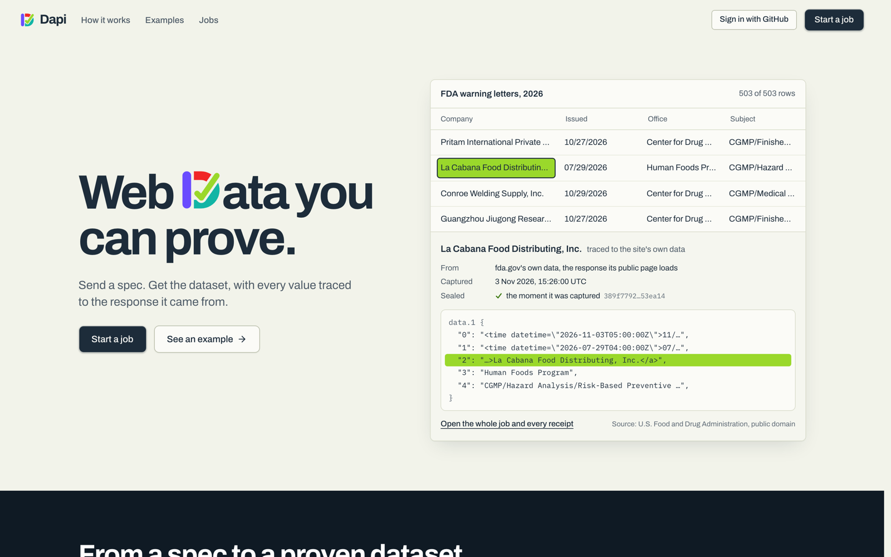
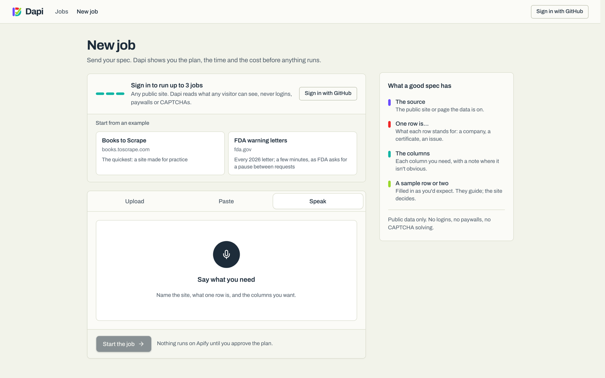
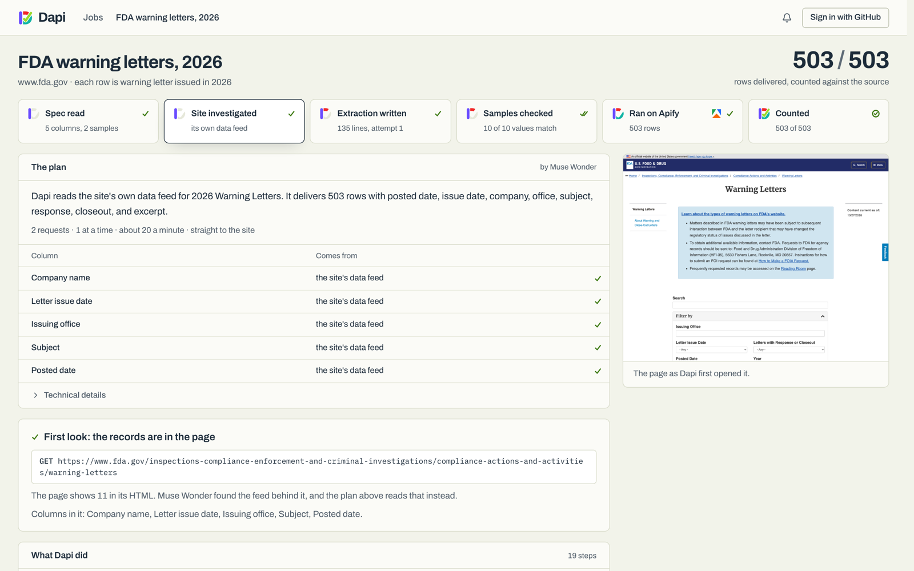
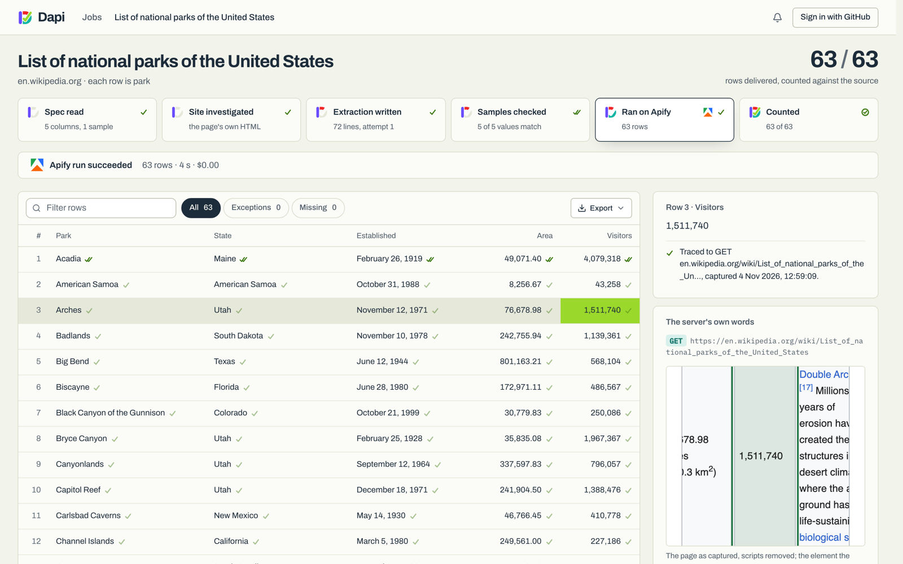

# Dapi

**Web data you can prove.** Send a spec (the site, the columns you need, a sample row or
two) by typing it, uploading it or saying it, and Dapi delivers the dataset, with a
receipt for every value and every row counted against the source's own total.

**Live:** [dapi.fly.dev](https://dapi.fly.dev)



Dapi is for people who need web data they can stand behind and don't write scrapers: a
compliance officer checking a public register, an analyst tracking competitors, a
researcher, a data engineer who'd rather not babysit scrapers, a team gathering training
data for AI that has to show where every value came from. Nobody sees code unless they
want to.

## Try it

Open [dapi.fly.dev](https://dapi.fly.dev). The finished example jobs (Books to Scrape, US
national parks, FDA warning letters) are open to everyone: click any value to see its
receipt. Sign in with GitHub to run up to three jobs of your own: start from an example,
paste or upload a spec, or press the mic and say what you need.

## How it works

Six steps, from what you ask for to a dataset you can check.

| Step | What happens | Done by |
| --- | --- | --- |
| **1. Ask** | You type, upload or say what you need: the site, the columns, a sample row, any rules. | Muse Voice Transcribe hears it; Muse Spark writes it up and reads it into columns, samples and rules |
| **2. Investigate** | Dapi opens the site and watches what it loads before reading any HTML. Many sites load their data from a feed of their own: Dapi reads that instead of scraping the page. Then an agent settles where every column lives and plans the run. | Muse Wonder, as an agent with tools |
| **3. Write and test** | The extraction is written and tested against your sample rows; a failed test goes back for a fix. Where the site shows something other than your sample, Dapi delivers what the site shows and says so. | Muse Spark |
| **4. Plan** | The records, the requests, the time and the cost, and anything worth a look. Nothing runs until you press Go. | Dapi |
| **5. Run** | It runs on Apify and rows arrive as they're found. A run that breaks is stopped, its log goes back for a fix, and a fresh run starts. | Apify, Muse Spark |
| **6. Prove** | Every response is sealed with SHA-256 the moment it arrives. Click any value to see the page or response it came from, with the value marked. Rows are counted against the source's own total, and anything missing is named. | Dapi |

**Ask by saying it.** Upload a PDF, paste text, or press the mic.



**The investigation.** FDA's list page shows its letters a few at a time; Muse Wonder
found the feed behind it and reads all 503 from there.



**A receipt for every value.** Click a number and see the page it came from, as Dapi
captured it, with that number outlined, when it was captured, and its seal.



## Meta's models in Dapi

| Model | What it does here |
| --- | --- |
| **Muse Wonder** (`muse-wonder-1.0`) | Runs the investigation as an agent on the Responses API, with tools to search the web, look at pages, click and watch the network, test endpoints and search a page's source; then plans the extraction for every column (`src/agent.js`, `src/strategy.js`). |
| **Muse Spark** (`muse-spark-1.3`) | Reads the spec into columns, samples and rules; looks at a screenshot to choose what opens a record's details; writes the extraction and repairs it from a failed run's log; translates values into the language asked for; writes everything the client reads in plain words (`src/read-spec.js`, `src/write-site.js`, `src/translate.js`). |
| **Muse Voice Transcribe** | Turns a spoken brief into text, which Muse Spark writes up as a spec (`src/voice.js`). |

## Rules Dapi keeps

- Public data only: what any visitor can see. No logins, no paywalls.
- A check that wants a person (a CAPTCHA, "verify you are human") is set aside, never
  solved. No challenge-solving services.
- robots.txt is obeyed, including the pause it asks for between requests.
- Never an address on the server's own network (`src/net-guard.js`).
- Receipts show only the fields a job delivers, never everything else a site sent.

## Run it yourself

You need Node.js 22 or later, an [Apify](https://apify.com) account and a Meta Model API
key.

```sh
cp .env.example .env              # then add MODEL_API_KEY and APIFY_TOKEN
npm install
(cd web && npm install)
node src/apify/deploy-runner.js   # builds the dapi-runner Actor on your Apify account
cd web && npm run dev             # http://localhost:3000
```

Jobs can also run from the terminal:

```sh
node src/jobs/run-job.js --new specs/books-to-scrape.md
```

`specs/` holds example specs. `npm test` runs the tests, and
`node src/investigate/suite.js` runs the investigation against sites built in different
ways.

## Deploy

[DEPLOY.md](DEPLOY.md) puts Dapi on one Fly.io machine as a public demo: anyone can open
the example jobs, and anyone signed in with GitHub can run a few jobs of their own,
inside limits that keep the owner's Meta and Apify accounts in budget. A read-only copy,
where nothing runs, is one setting away.

In production, each user would sign in and connect their own Apify account, so their
jobs, data and costs stay in their account.

## Layout

| Folder | What's there |
| --- | --- |
| `src/` | The pipeline: spec reading, investigation, the Muse agent and strategy, code writing and testing, the job runner. |
| `src/frame/` | The frame each extraction runs inside on Apify: it keeps the evidence and does the counting. |
| `runner/` | The `dapi-runner` Actor's definition. |
| `web/` | The Next.js app: home page, jobs, receipts. |
| `specs/` | The example specs: Books to Scrape, US national parks, FDA warning letters. |
| `test/` | Tests (`npm test`). |
| `scripts/` | `spec-to-pdf.js`: turns a written spec into a PDF, the way clients send them. |
| `deploy/`, `Dockerfile`, `fly.toml` | The public demo's container and host. |
| `docs/images/` | The screenshots in this README. |

## Built for the Meta Global AI Developer Hackathon

Everything in this repository was written during the hackathon (26 October to 4 November
2026). Libraries are dependencies, listed in `package.json` and `web/package.json`:
Crawlee and the Apify SDK and client, Playwright, Next.js, shadcn/ui on Radix, Magic UI
components, fflate and Lucide icons.

Apify and the Apify logo are trademarks of Apify Technologies; they're used to credit the
platform Dapi runs on. Example data: Books to Scrape, a site made for practising
extraction; Wikipedia's list of US national parks, CC BY-SA 4.0; FDA warning letters,
public domain.

## Licence

[MIT](LICENSE). Copyright (c) 2026 Waweru Wallicestene.
